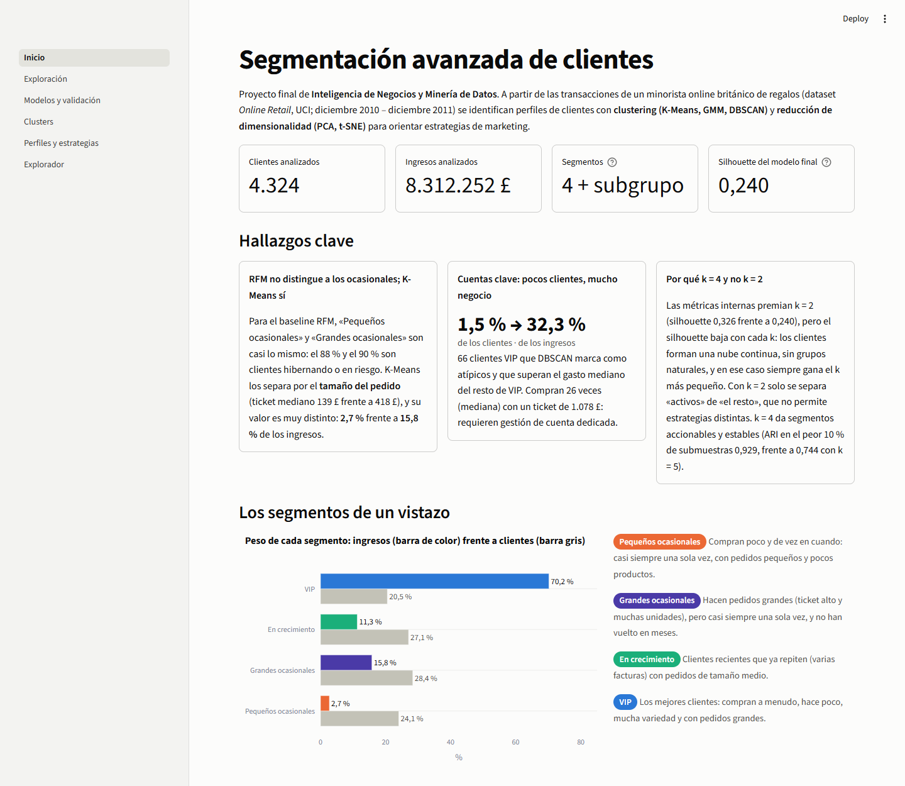
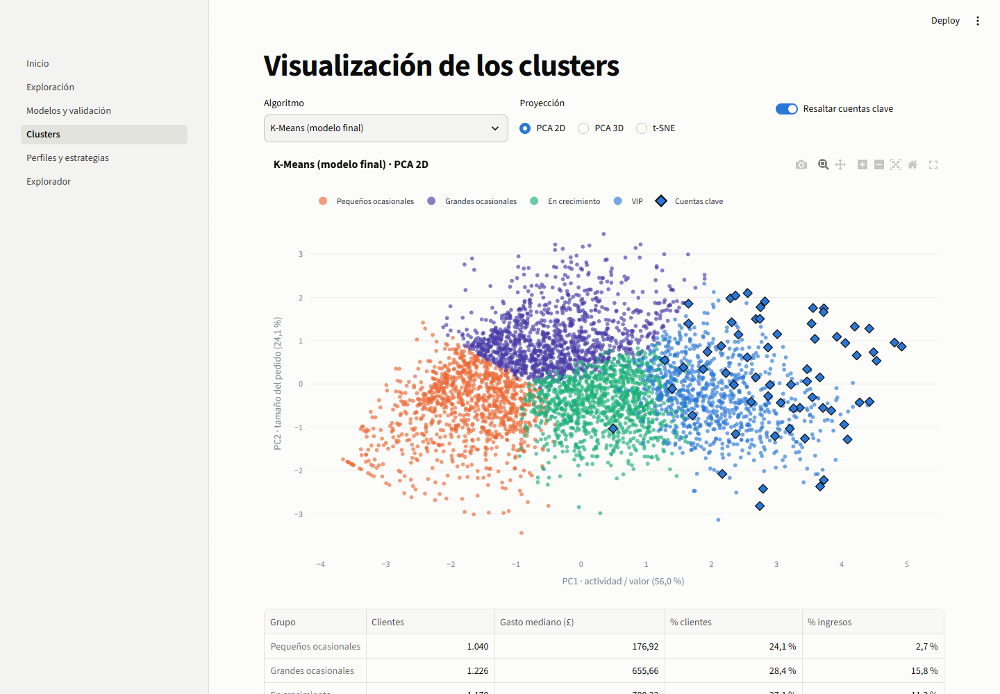
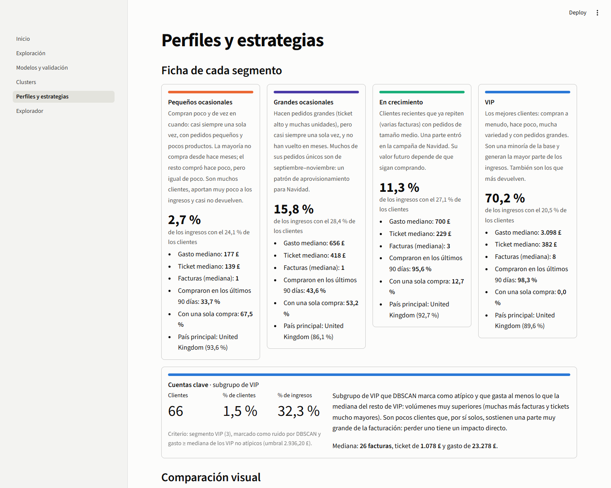
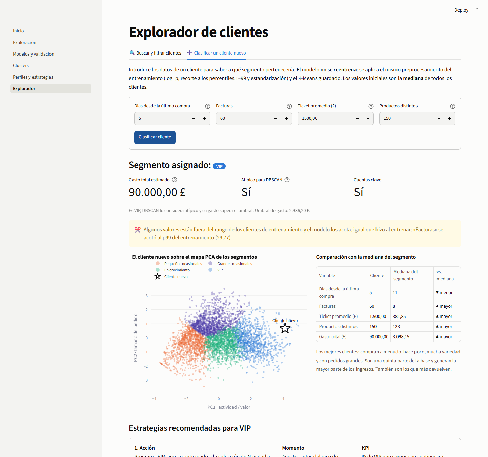

# Segmentación avanzada de clientes · Online Retail (UCI)

Proyecto final de **Inteligencia de Negocios y Minería de Datos** (Ingeniería de Software). Es un sistema de
segmentación de clientes que combina **clustering (K-Means, GMM, DBSCAN/HDBSCAN)** y **reducción de dimensionalidad
(PCA, t-SNE)** sobre las transacciones del dataset [Online Retail](https://archive.ics.uci.edu/dataset/352/online+retail),
con validación, perfilamiento, estrategias de marketing y un dashboard web en Streamlit.

**App publicada:** https://segmentacion-retail-ucc.streamlit.app

## Resultados clave

- **4.324 clientes** analizados tras limpiar 541.909 líneas de factura. Las cancelaciones se emparejan
  con las compras que anulan para no inflar el gasto.
- **Modelo final: K-Means con k = 4** sobre recency, frecuencia, ticket promedio y productos distintos (log1p,
  recorte p1–p99 y estandarización). Silhouette 0,240; estabilidad mediana 0,958 y
  0,929 en el peor 10 % de 50 submuestras.
- **Exactitud con datos de prueba:** entrenado sin ver a un grupo de clientes, el modelo les asigna el mismo segmento
  que el modelo final en el **98,2 %** de los casos (validación cruzada de 5 pliegues). Un
  árbol de decisión aprende los segmentos con un **91,3 %** de exactitud en prueba y un bosque aleatorio con
  un **94,7 %** (partición 80 % / 20 %).
- **Segmentos:**

  | Segmento | % clientes | % ingresos |
  |---|---|---|
  | VIP | 20,5 % | 70,2 % |
  | En crecimiento | 27,1 % | 11,3 % |
  | Grandes ocasionales | 28,4 % | 15,8 % |
  | Pequeños ocasionales | 24,1 % | 2,7 % |

- **Cuentas clave:** 66 clientes VIP atípicos según DBSCAN (1,5 % de los clientes) que generan el
  32,3 % de los ingresos.
- **Valor frente al baseline RFM:** RFM no distingue a los dos grupos de ocasionales; K-Means los separa por el tamaño
  del pedido (2,7 % frente a 15,8 % de los ingresos).
- Las métricas internas preferían k = 2, pero en una nube continua siempre gana el k mínimo; k = 4 equilibra
  métricas, estabilidad y utilidad. El razonamiento completo está en el [informe](reports/INFORME.md).

## Capturas

| Inicio | Clusters |
|---|---|
|  |  |
| **Perfiles y estrategias** | **Clasificar un cliente nuevo** |
|  |  |

## La app

1. **Inicio:** objetivo, indicadores y hallazgos clave.
2. **Exploración:** limpieza y patrones de venta.
3. **Modelos y validación:** comparación de algoritmos y justificación del modelo final.
4. **Clusters:** PCA 2D y 3D y t-SNE (con advertencia) con selector de algoritmo.
5. **Perfiles y estrategias:** fichas, radar, snake plot y acciones con su KPI.
6. **Explorador:** filtros, búsqueda por ID, descarga en CSV y clasificación de un cliente nuevo sobre el mapa PCA.

## Ejecutar en local

Requiere Python 3.11.

```bash
git clone https://github.com/Andres766/proeyecto-mineria-de-datos.git
cd proeyecto-mineria-de-datos
python -m venv .venv
# Windows: .venv\Scripts\activate    ·    Linux/macOS: source .venv/bin/activate
pip install -r requirements.txt
streamlit run app/Inicio.py
```

La app solo necesita `requirements.txt`: los modelos y los datos procesados ya están en el repositorio y no se
reentrena nada.

### Con Docker

```bash
docker build -t segmentacion-clientes .
docker run --rm -p 8501:8501 segmentacion-clientes
```

Después abre http://localhost:8501.

## Reproducir el análisis completo

```bash
pip install -r requirements-dev.txt
# Windows (PowerShell): $env:PYTHONPATH = "src"    ·    Linux/macOS: export PYTHONPATH=src
python -m segmentacion.carga        # descarga el dataset (UCI) y lo guarda en parquet
python -m segmentacion.limpieza     # limpieza y bitácora
jupyter nbconvert --to notebook --execute --inplace notebooks/01_eda.ipynb notebooks/02_features.ipynb notebooks/03_modelado.ipynb notebooks/04_perfiles.ipynb notebooks/05_validacion.ipynb
python -m segmentacion.reportes     # informe, guía de sustentación, guion y este README (cifras calculadas)
python scripts/exportar_informe.py  # informe en Word y PDF (el PDF requiere Microsoft Word)
pytest                              # 106 pruebas
```

Los notebooks se ejecutan en orden: el 04 completa el archivo de clientes segmentados que genera el 03, y el 05 mide la
exactitud con datos de prueba sobre ese archivo.

## Estructura

```
app/                Inicio.py + pages/ (Streamlit multipágina)
data/processed/     transacciones limpias, devoluciones, bitácora, clientes con variables y segmentos
models/             preprocesadores, K-Means, GMM, PCA, núcleos de DBSCAN y métricas, segmentos y validación en JSON
notebooks/          01_eda · 02_features · 03_modelado · 04_perfiles · 05_validacion (ejecutados, con salidas)
reports/            INFORME (md, docx, pdf), GUIA_SUSTENTACION, GUION_DEMO, figures/ y plantillas/
scripts/            exportación del informe a Word/PDF
src/segmentacion/   carga, limpieza, features, modelado, evaluacion, perfilamiento, catalogo, prediccion, reportes
tests/              pytest: limpieza, features, modelado, evaluación, perfilamiento, predicción, app y reportes
Dockerfile          alternativa de despliegue
```

## Documentos

- [Informe final](reports/INFORME.md), también en [Word](reports/INFORME.docx) y [PDF](reports/INFORME.pdf).
- [Guía de sustentación](reports/GUIA_SUSTENTACION.md): conceptos explicados y 31 preguntas con respuesta.
- [Resumen para la exposición](reports/RESUMEN_EXPOSICION.md) ([PDF](reports/RESUMEN_EXPOSICION.pdf)): lo esencial, la exactitud y
  los ajustes, y preguntas probables con respuestas cortas.
- [Guion de la demo](reports/GUION_DEMO.md): presentación de la app en 5–7 minutos.
- [Guía de despliegue](DESPLIEGUE.md): Streamlit Community Cloud paso a paso y Docker.

## Datos

Chen, D. (2015). *Online Retail* [Dataset]. UCI Machine Learning Repository. El dataset crudo no se incluye en el
repositorio: se descarga con `python -m segmentacion.carga`. Solo se versionan los datos procesados que usa la app.
