# Segmentación avanzada de clientes con clustering y reducción de dimensionalidad

Proyecto final · Inteligencia de Negocios y Minería de Datos · Ingeniería de Software

## Resumen

Este trabajo diseña un sistema de segmentación de clientes para un minorista online británico de artículos de regalo a
partir del dataset *Online Retail* (UCI). Las transacciones originales (541.909 líneas) se limpiaron hasta
388.422 líneas de venta de 4.324 clientes, con un tratamiento explícito de las cancelaciones que anulan
compras. Por cada cliente se construyeron variables de comportamiento (recency, frecuencia, ticket promedio y variedad
de productos), se transformaron con log1p, se recortaron a los percentiles 1–99 y se estandarizaron. Se compararon tres
familias de algoritmos (K-Means, mezclas gaussianas y DBSCAN/HDBSCAN) y se usaron PCA y t-SNE para interpretar y
visualizar. La validación combinó métricas internas, estabilidad por remuestreo, robustez a los empates de la variable
frecuencia, concordancia con un baseline RFM por quintiles, pruebas de exactitud con datos de entrenamiento y de prueba,
y un criterio de negocio.

El modelo final es **K-Means con k = 4** (silhouette 0,240, estabilidad mediana
0,958). Al clasificar clientes que no vio al entrenar, coincide con el segmento final en el
98,2 % de los casos, y un árbol de decisión reproduce los segmentos con un 91,3 % de exactitud
en prueba. Da cuatro segmentos accionables: **VIP** (20,5 % de los clientes y
70,2 % de los ingresos), **En crecimiento**, **Grandes ocasionales** y **Pequeños ocasionales**. Dentro de VIP, el cruce con los
atípicos de DBSCAN identifica un subgrupo de **cuentas clave**: 66 clientes (1,5 %) que
generan el 32,3 % de los ingresos. Cada segmento tiene estrategias de marketing con acción, momento y KPI.
Los resultados se publican en un aplicativo web en Streamlit.

## 1. Introducción

Segmentar clientes permite dejar de tratar a todos por igual: concentrar recursos en quienes generan más valor,
recuperar a quienes se están yendo y no gastar en acciones caras con quien no va a responder. El enfoque clásico es el
análisis RFM (Recency, Frequency, Monetary), que puntúa a cada cliente por quintiles. Es sencillo y explicable, pero
sus cortes son arbitrarios y no usan la estructura conjunta de los datos.

**Objetivo.** Diseñar un sistema de segmentación basado en clustering y reducción de dimensionalidad que identifique
perfiles de clientes útiles para estrategias de marketing, validarlo con rigor y desplegarlo en un aplicativo web.

**Alcance.** El proyecto cubre todo el ciclo:

1. Análisis exploratorio y limpieza documentada.
2. Ingeniería de características a nivel de cliente.
3. Comparación de K-Means, GMM y DBSCAN (y HDBSCAN), con PCA y t-SNE.
4. Validación interna, de estabilidad y de negocio.
5. Perfilamiento con estrategias.
6. Un dashboard desplegable.

Todas las cifras de este informe salen de ejecutar el código del repositorio: el documento se genera desde una
plantilla con `python -m segmentacion.reportes`.

## 2. Datos

El dataset *Online Retail* (Chen, Sahinoglu y Guo, 2012) contiene las transacciones de una tienda online británica
entre el 1 de diciembre de 2010 y el 9 de diciembre de 2011 (último registro). Cada fila es una línea de factura con ocho columnas:

- número de factura (`InvoiceNo`; las que empiezan por "C" son cancelaciones);
- código y descripción del producto;
- cantidad, fecha y hora, y precio unitario;
- identificador de cliente (`CustomerID`) y país.

Muchos de sus clientes son mayoristas, lo que produce distribuciones muy asimétricas.

## 3. Metodología

El trabajo sigue las fases de un proyecto de minería de datos: comprensión y preparación de los datos, modelado,
evaluación y despliegue.

- **Herramientas:** Python 3.11, pandas, scikit-learn, Plotly y Streamlit.
- **Organización del código:** la lógica está en un paquete (`src/segmentacion`: carga, limpieza, características,
  modelado, evaluación, perfilamiento y predicción) y los notebooks solo la invocan y narran los resultados.
- **Reproducibilidad:** todos los procesos aleatorios usan `random_state = 42`, las dependencias tienen versiones fijas
  y el proyecto incluye 106 pruebas automáticas (limpieza, características, modelado, medidas de exactitud,
  clasificación de clientes nuevos y la propia aplicación).

Las decisiones se tomaron comparando alternativas con datos y no por convención. Las más relevantes:

- el emparejamiento de compras anuladas;
- la exclusión de variables redundantes o no definidas;
- el tratamiento de los clientes extremos;
- el `reg_covar` de GMM;
- el `eps` de DBSCAN;
- el número de segmentos.

## 4. Análisis exploratorio y limpieza

### 4.1 Calidad de los datos

- **Clientes sin identificar.** El 24,93 % de las líneas no tiene `CustomerID`. Suponen el
  16,46 % del importe vendido y faltan por factura completa (compras sin cliente registrado). No se
  pueden imputar porque no hay forma de saber de quién son, así que se excluyen. La segmentación describe, por tanto, a
  los clientes registrados.
- **Duplicados.** Hay 5.268 filas duplicadas exactas.
- **Cancelaciones.** Las facturas canceladas restan el equivalente al 8,4 % de lo vendido.
- **Códigos que no son producto.** Se identificaron revisando sus descripciones: portes, comisiones, descuentos,
  ajustes manuales y bonos regalo.

### 4.2 Cancelaciones y compras anuladas

Los dos mayores valores de cantidad del dataset (hasta 80.995 unidades) son compras que el mismo
cliente canceló minutos después. Si solo se eliminaran las facturas "C", esas compras quedarían como ventas reales e
inflarían el gasto. Por eso la limpieza **empareja cada cancelación con la compra que anula**: mismo cliente, producto,
cantidad y precio, la compra más reciente anterior a la cancelación, con emparejamiento 1 a 1.

Además, algunas anulaciones se registran con el código manual `M` por el importe total. Se aplica una regla
conservadora: misma persona, mismo importe exacto y menos de 24 horas entre la compra y la anulación. En total se
anularon 2.731 compras (2.726 por cancelación exacta y 5 por anulación
manual).

Las pruebas automáticas detectaron un error en la primera versión del emparejamiento. Cuando un cliente tenía dos
compras idénticas y dos cancelaciones idénticas, solo se anulaba una compra, porque ambas cancelaciones apuntaban a la
misma. Se corrigió con un emparejamiento iterativo realmente 1 a 1 y se regeneraron todos los resultados.

*Tabla 1. Bitácora de limpieza (filas antes y después de cada paso).*

| Paso | Filas antes | Filas después | Eliminadas | % eliminado |
|---|---|---|---|---|
| 1. Duplicados exactos | 541.909 | 536.641 | 5.268 | 0,97 % |
| 2. Sin CustomerID | 536.641 | 401.604 | 135.037 | 25,16 % |
| 3. Códigos que no son producto | 401.604 | 399.693 | 1.911 | 0,48 % |
| 4. Separar cancelaciones (factura 'C') | 399.693 | 391.187 | 8.506 | 2,13 % |
| 5. Cantidad o precio &lt;= 0 | 391.187 | 391.153 | 34 | 0,01 % |
| 6. Compras anuladas por cancelación posterior | 391.153 | 388.422 | 2.731 | 0,70 % |

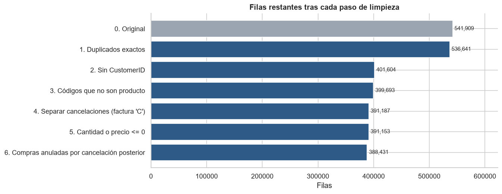

*Figura 1. Filas restantes tras cada paso de limpieza*

El resultado son 388.422 líneas, 18.279 facturas, 4.324 clientes, 3.646 productos de 37
países y 8.312.251,80 £ en ventas.

### 4.3 Patrones de venta

Las ventas tienen una fuerte estacionalidad de fin de año: el mes de mayor facturación es noviembre de 2011
(1.123.655 £). Diciembre de 2011 solo llega hasta el día 9: se conserva para calcular la recency, pero se marca
como incompleto en los gráficos.

No hay ventas en sábado (0 facturas) y la hora con más pedidos son las 12 h. Este horario
laboral, sumado a pedidos de gran tamaño, indica una clientela en buena parte mayorista (B2B). Reino Unido concentra el
90,4 % de los clientes y el 82,3 % de los ingresos.

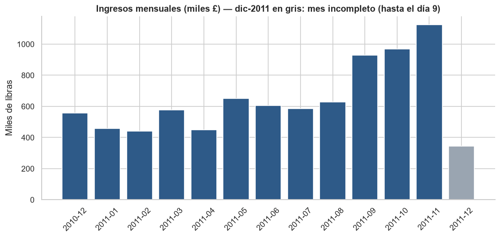

*Figura 2. Ingresos mensuales (diciembre de 2011, en gris, está incompleto)*

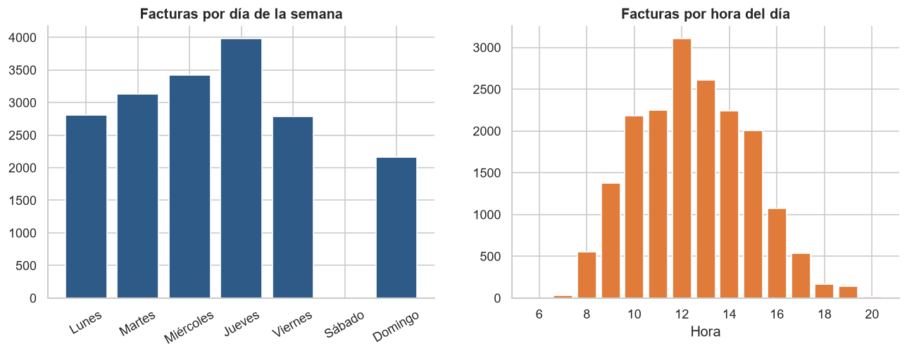

*Figura 3. Facturas por día de la semana y por hora*

### 4.4 Distribuciones y concentración

Todas las variables son muy asimétricas a la derecha. El 1 % de los clientes genera el 30,2 % de los
ingresos. En escala logarítmica las distribuciones se vuelven aproximadamente simétricas, lo que justifica transformar
con log1p antes de usar algoritmos basados en distancias.

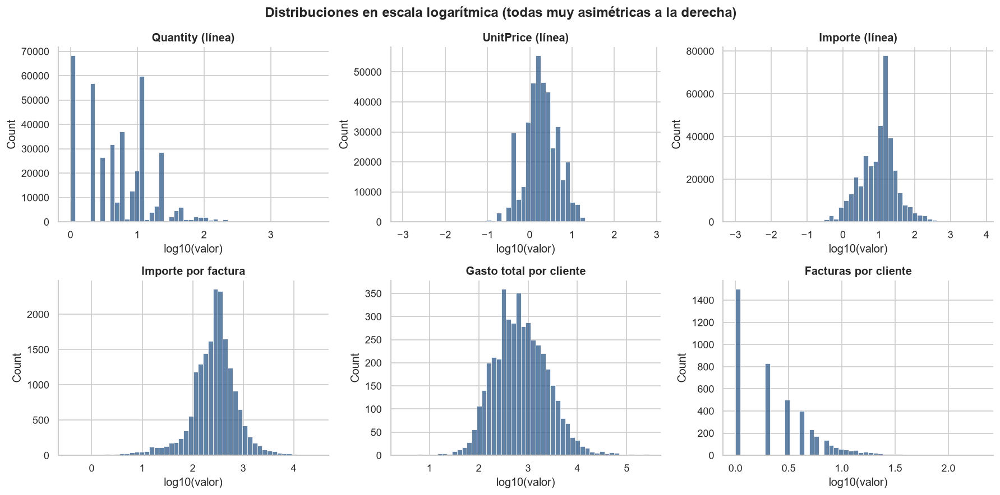

*Figura 4. Distribuciones en escala logarítmica*

## 5. Ingeniería de características

### 5.1 Variables por cliente

Se calcularon, para cada cliente:

- **Recency:** días entre la fecha de referencia (10 de diciembre de 2011, el día siguiente al último registro) y la última
  compra.
- **Frequency:** número de facturas distintas.
- **Monetary:** gasto total.
- **Ticket promedio**, **productos distintos**, **antigüedad**, **días promedio entre compras**, **unidades por
  factura** y **tasa de devoluciones**.

### 5.2 Días entre compras

La variable no está definida para los 1.503 clientes de una sola factura (34,8 %). Se
compararon cuatro alternativas:

| Alternativa | Problema |
|---|---|
| Imputar con la mediana (54,55 días) | Crea un pico artificial en un tercio de la base |
| Imputar con la recency | Duplica una variable que ya está en el modelo |
| Variable indicadora | Coincide exactamente con frequency = 1 |
| Excluirla del clustering | Entre los clientes recurrentes correlaciona -0,453 con frequency |

Se excluyó del clustering y se usa solo para perfilar.

### 5.3 Tasa de devoluciones

Se define de forma coherente con la limpieza: importe devuelto computable dividido entre el importe comprado.

- No cuentan las cancelaciones emparejadas, cuyas compras ya se eliminaron.
- Del resto solo cuentan las unidades que caben en lo que el cliente compró antes de ese producto dentro del periodo.
  Las devoluciones de compras anteriores al inicio de los datos computan 0.
- La tasa se recorta a [0, 1] por robustez. El máximo observado es 0,6451.

El 73,5 % de los clientes tiene tasa 0. Incluirla en el clustering crea un grupo pequeño
(160 clientes, 3,7 %) formado al 100 % por clientes que devuelven, y sube
el silhouette de forma engañosa (de 0,258 a 0,316 con k = 3). Por eso se usa
solo para perfilar.

### 5.4 Selección de variables

El gasto total es exactamente frecuencia × ticket promedio, así que en escala logarítmica es una suma de las otras dos.
Con las tres juntas el factor de inflación de la varianza (VIF) se dispara: 199 en monetary, 92
en frequency y 70 en el ticket. Además, frequency y monetary correlacionan 0,808, y el
ticket y las unidades por factura, 0,814.

El conjunto elegido es **recency, frequency, ticket promedio y productos distintos**: VIF máximo 2,018 y
correlación máxima entre pares de 0,656. El gasto total no se pierde, porque queda recogido en frecuencia ×
ticket y se usa para perfilar. La antigüedad se excluyó porque es idéntica a la recency en todos los clientes de una
sola compra.

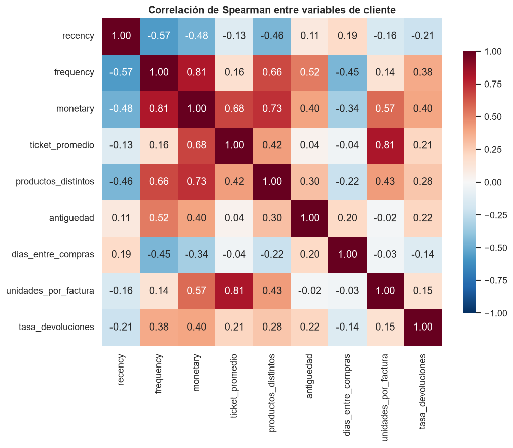

*Figura 5. Correlación de Spearman entre variables de cliente*

### 5.5 Transformación, escalado y clientes extremos

- **Transformación:** log1p deja las cuatro variables aproximadamente simétricas.
- **Escalado:** se eligió StandardScaler porque da a todas las variables el mismo peso. RobustScaler obtenía un
  silhouette como mucho 0,015 mayor, pero a costa de dar más peso al ticket.
- **Clientes extremos:** los 91 clientes con |z| > 3 en alguna variable generan el
  29,7 % de los ingresos, así que excluirlos dejaría fuera a los clientes más valiosos. Se recortó cada
  variable (en escala log) a sus percentiles 1 y 99. Afecta a 216 clientes (5,0 %) y solo
  modifica la entrada del modelo, no sus valores reales.

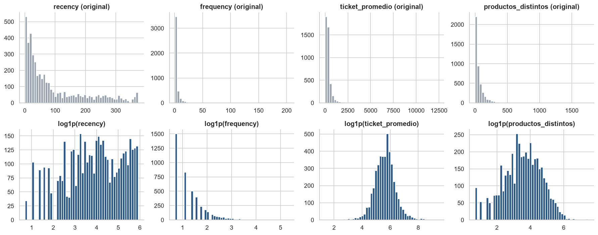

*Figura 6. Variables antes y después de log1p*

### 5.6 Baseline RFM

Como referencia se construyó la segmentación RFM clásica: puntuaciones de 1 a 5 por quintiles y diez segmentos según
el mapa R × F (Campeones, Leales, En riesgo, Hibernando, etc.). Tiene una limitación: como un tercio de los clientes
tiene frequency = 1, los quintiles de F se cortan en parte por orden de aparición.

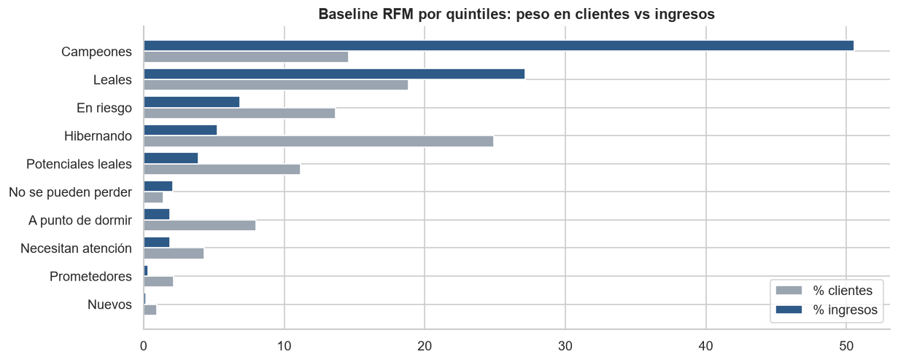

*Figura 7. Baseline RFM: peso de cada segmento en clientes e ingresos*

## 6. Modelado

### 6.1 Reducción de dimensionalidad con PCA

PCA sobre las cuatro variables estandarizadas: la primera componente explica el 56,0 % de la varianza y la segunda
el 24,1 % (juntas, el 80,2 %). Sus cargas permiten interpretarlas:

- **PC1 = actividad / valor:** más facturas y más productos distintos, compras más recientes.
- **PC2 = tamaño del pedido:** ticket alto y compras más espaciadas.

Clusterizar sobre 2 o 3 componentes no mejoró la calidad medida en el espacio original. El silhouette calculado en el
espacio PCA sale inflado porque ignora la varianza descartada. Se clusterizó sobre las cuatro variables y PCA se usa
para interpretar y visualizar.

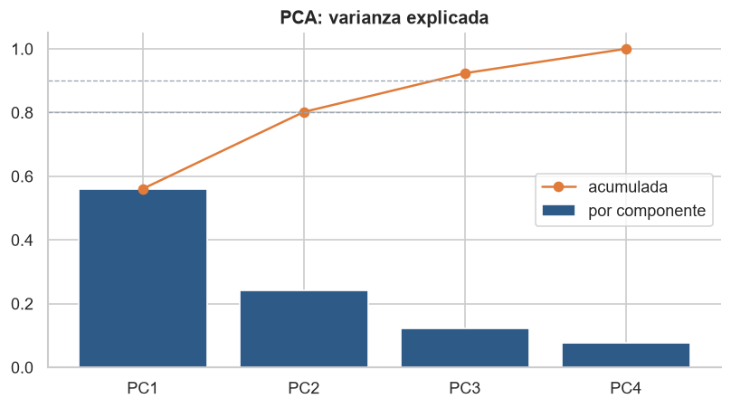

*Figura 8. PCA: varianza explicada*

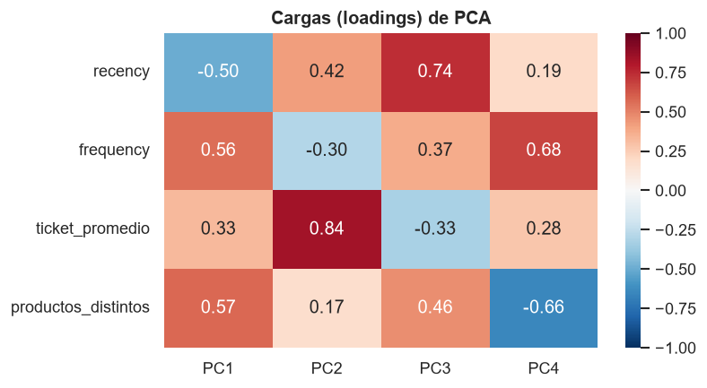

*Figura 9. Cargas de las componentes principales*

### 6.2 K-Means

Se evaluó k = 2 a 10 con la inercia (método del codo), el silhouette, Davies-Bouldin y Calinski-Harabasz. Las métricas
internas favorecen k = 2 (silhouette 0,326) y empeoran poco a poco al subir k. La estabilidad se midió con 50
submuestras del 80 %, reajustando el modelo y comparando con el ARI.

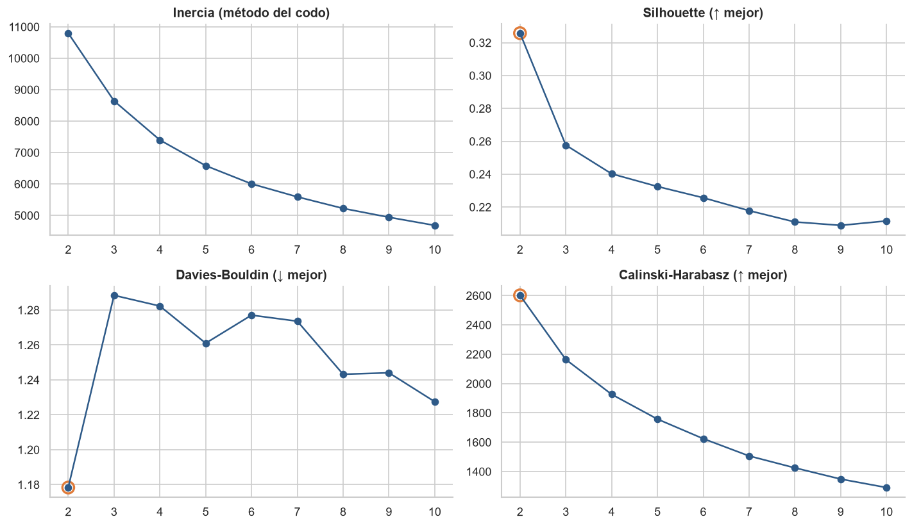

*Figura 10. Métricas de K-Means para k = 2 a 10*

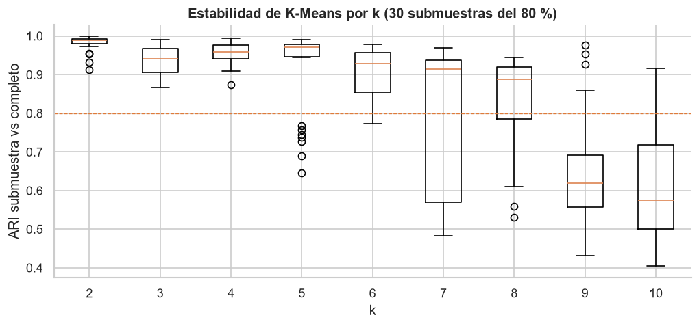

*Figura 11. Estabilidad de K-Means por k*

### 6.3 Mezclas gaussianas (GMM) y componentes degenerados

Con la regularización por defecto de scikit-learn (`reg_covar` = 1e-6), GMM degenera. Coloca componentes exactamente
sobre el valor frequency = 1, compartido por un tercio de los clientes, con varianza casi nula en esa dimensión. La
verosimilitud crece sin límite y el BIC baja artificialmente hasta 6.257.

Se definió un criterio de degeneración (varianza empírica de un componente en frequency menor que 0,01) y se buscó el
`reg_covar` mínimo que lo evita: **0,05**. Con ese valor, el menor BIC (42.026) corresponde a covarianza
full con 7 componentes. Aun así, el modelo resultante tiene un silhouette de 0,145, una
estabilidad mediana de 0,753 y un componente con solo el 2,9 % de los clientes.

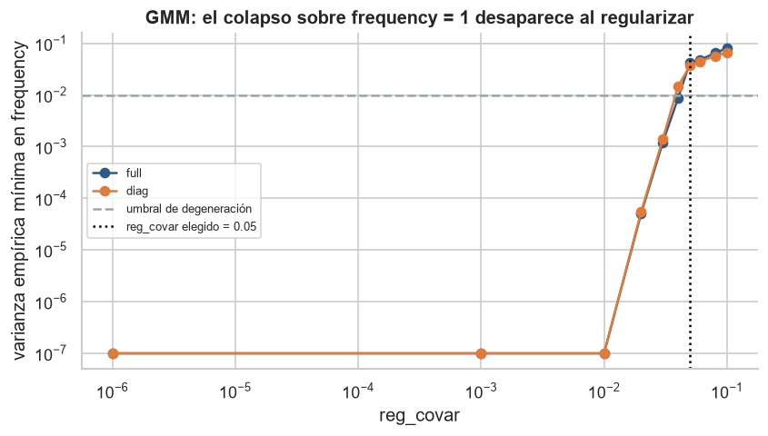

*Figura 12. Varianza empírica mínima frente a reg_covar*

### 6.4 DBSCAN y HDBSCAN

- **Parámetros de DBSCAN:** `min_samples` = 8 (dos veces el número de variables) y `eps` = 0,717, tomado del
  codo del gráfico de k-distancias.
- **Falsas zonas densas por los empates.** Los clientes con frequency = 1 tienen una distancia mediana a su octavo
  vecino de 0,276, frente a 0,415 en el resto. Parecen más densos solo porque comparten coordenada. Con eps
  menor que el hueco entre frequency = 1 y 2 (0,596), los "clusters" de DBSCAN son rebanadas de un único
  valor de frecuencia.
- **Resultado de DBSCAN:** con el eps del codo queda un único grupo denso y 163 clientes atípicos
  (3,8 %), que generan el 35,9 % de los ingresos.
- **HDBSCAN:** separa exactamente a los clientes de una factura del resto. Al romper los empates repartiendo la
  frecuencia dentro de su intervalo de redondeo, esa estructura desaparece (ARI 0,041): es un
  artefacto.

Conclusión: no hay grupos separados por densidad. DBSCAN se usa para marcar atípicos, no para segmentar.

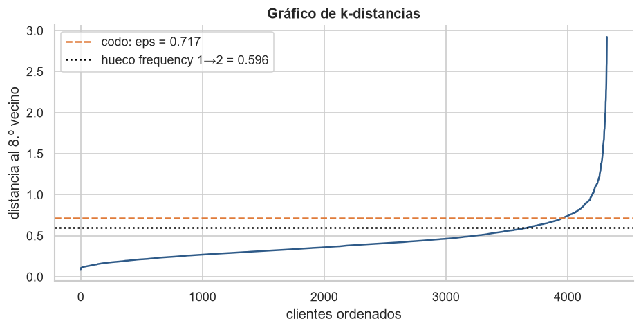

*Figura 13. Gráfico de k-distancias de DBSCAN*

### 6.5 t-SNE

t-SNE se usó solo para visualizar, con perplexities de 5, 30, 50 y 100. Conserva vecindarios locales, pero no las
distancias entre grupos ni sus tamaños, y el dibujo cambia con la perplexity. Se comprobó con los datos: el segmento
más disperso en realidad (segmento 3) aparece como el más compacto en el mapa (segmento
3). Por eso no se usó para validar.

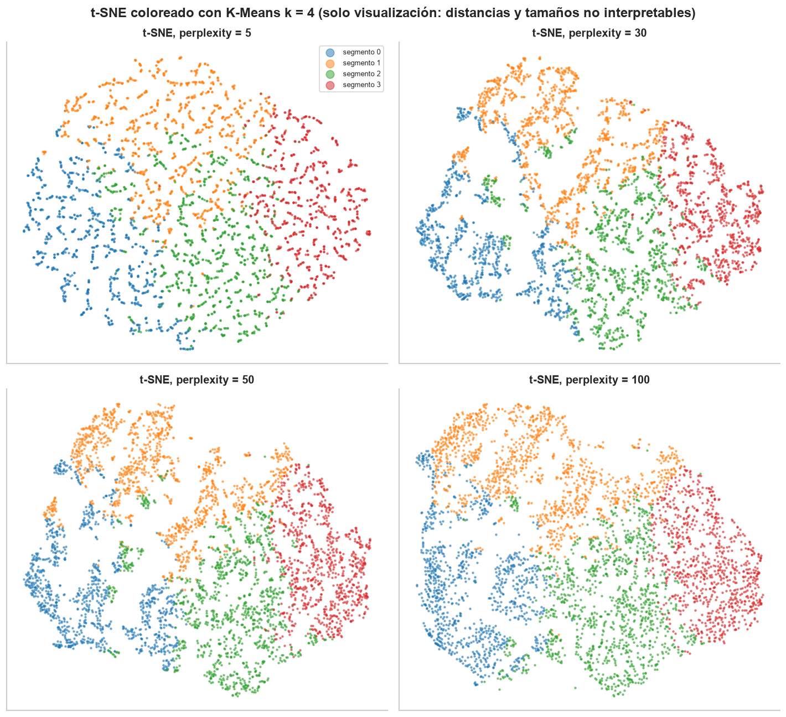

*Figura 14. t-SNE con distintas perplexities, coloreado con los segmentos de K-Means*

## 7. Validación y elección del modelo

*Tabla 2. Comparación de los modelos candidatos (métricas en el mismo espacio; en DBSCAN y HDBSCAN el ruido se excluye).*

| Modelo | Clusters | Silhouette ↑ | Davies-Bouldin ↓ | Estabilidad mediana ↑ | Estabilidad p10 ↑ | Robustez a empates ↑ | % ruido |
|---|---|---|---|---|---|---|---|
| K-Means k=2 | 2 | 0,326 | 1,178 | 0,987 | 0,955 | 0,943 | 0,0 % |
| K-Means k=4 | 4 | 0,240 | 1,282 | 0,958 | 0,929 | 0,941 | 0,0 % |
| K-Means k=5 | 5 | 0,232 | 1,261 | 0,971 | 0,744 | 0,936 | 0,0 % |
| K-Means k=6 | 6 | 0,226 | 1,277 | 0,914 | 0,839 | 0,918 | 0,0 % |
| GMM full k=7 (BIC) | 7 | 0,145 | 1,611 | 0,753 | 0,378 | 0,841 | 0,0 % |
| GMM full k=5 | 5 | 0,101 | 2,369 | 0,590 | 0,481 | 0,799 | 0,0 % |
| DBSCAN | 1 | — | — | 0,903 | 0,884 | 0,892 | 3,8 % |
| HDBSCAN | 2 | 0,250 | 1,361 | 0,925 | 0,918 | 0,041 | 15,2 % |

### 7.1 Estabilidad: k = 4 frente a k = 5

k = 5 tiene la mejor estabilidad mediana (0,971), pero su percentil 10 cae a
0,744. Tiene dos soluciones casi igual de buenas: las alternativas solo tienen entre un 0,12 % y
un 0,20 % más de inercia que la mejor. En una parte de las submuestras sus segmentos se reorganizan, y lo que
cambia es precisamente su segmento distintivo (ticket alto). k = 4 mantiene 0,929 también en el peor
caso.

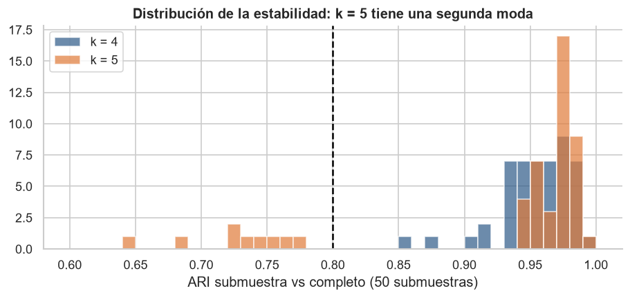

*Figura 15. Distribución de la estabilidad con k = 4 y k = 5*

### 7.2 Concordancia

El ARI del modelo final con el baseline RFM es 0,228. Es bajo en parte porque se comparan cuatro
segmentos con diez, pero la tabla cruzada (sección 8) muestra que encajan.

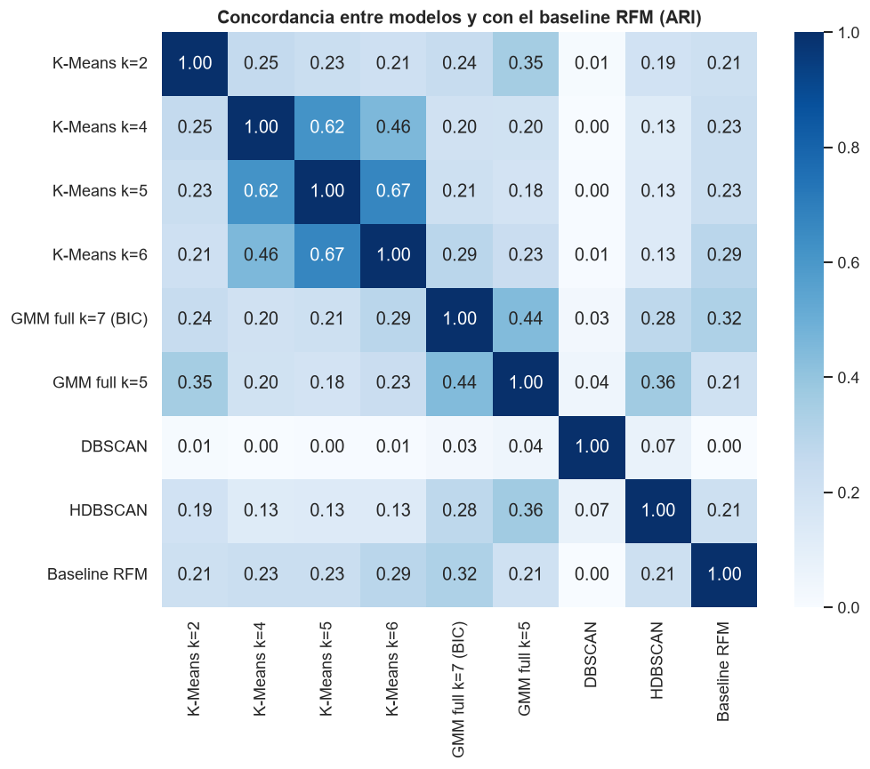

*Figura 16. Concordancia entre modelos y con el baseline RFM (ARI)*

### 7.3 Exactitud con datos de entrenamiento y de prueba

En un problema supervisado la exactitud compara la predicción con una etiqueta real. La segmentación es no supervisada:
no existe un «segmento verdadero» de cada cliente, así que la exactitud no se puede calcular sobre los clusters. Lo que sí
se puede medir, separando datos de **entrenamiento** y de **prueba**, es si los segmentos se reproducen con clientes que
el modelo no ha visto (notebook `05_validacion`). Se hicieron dos pruebas:

1. **Exactitud de reasignación.** Con validación cruzada estratificada de 5 pliegues se reentrena el
   proceso completo (log1p, límites de winsorizado, escalado y K-Means) sin los clientes de un pliegue y se les asigna
   segmento. Tras alinear la numeración de los clusters con el algoritmo húngaro (Kuhn, 1955), coinciden con el modelo
   final en el **98,2 %** de los casos (entre 96,8 % y 99,3 % según el
   pliegue). Es la operación que hace el aplicativo con un cliente nuevo, y es la idea de la validación por predicción
   de Lange et al. (2004).
2. **Clasificadores supervisados.** Con los segmentos como etiqueta, los clientes se dividieron en 80 %
   para entrenamiento (3.459) y 20 % para prueba (865), de forma estratificada.
   Los hiperparámetros se eligieron solo con validación cruzada dentro del entrenamiento (Kohavi, 1995), y el conjunto
   de prueba se usó una única vez al final.

*Tabla 3. Exactitud de los clasificadores que aprenden los segmentos (validación cruzada de 5 pliegues en el entrenamiento y conjunto de prueba de 865 clientes).*

| Clasificador | Exactitud en validación cruzada | Exactitud en prueba |
|---|---|---|
| Árbol de decisión (profundidad 3) | 79,4 % ± 1,8 % | 82,0 % |
| Árbol de decisión ajustado | 91,6 % ± 1,5 % | 91,3 % |
| Bosque aleatorio (300 árboles) | 95,3 % ± 0,5 % | 94,7 % |

El árbol de decisión (Breiman et al., 1984) se ajustó con una búsqueda en rejilla de 36
combinaciones de profundidad máxima y mínimo de clientes por hoja. La mejor es profundidad 10 con
mínimo 1 por hoja. La curva de la figura muestra el compromiso entre sencillez y exactitud: con
profundidad 3 el árbol acierta el 79,4 % en validación cruzada y con 5 el 87,7 %. A partir de
ahí la exactitud de validación se estanca, mientras la de entrenamiento sigue subiendo hasta el
100,0 %: más profundidad solo sobreajusta. El bosque aleatorio (Breiman, 2001) llega al
94,7 % en prueba. En todos los casos la exactitud en prueba es parecida a la de validación cruzada, señal de
que la estimación es fiable.

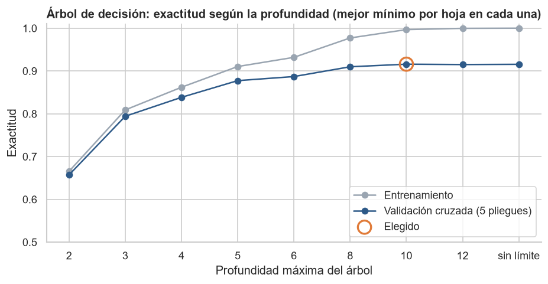

*Figura 17. Exactitud del árbol de decisión según su profundidad*

*Tabla 4. Precisión, sensibilidad y F1 del árbol ajustado por segmento (conjunto de prueba).*

| Segmento | Precisión | Sensibilidad | F1 | Clientes en prueba |
|---|---|---|---|---|
| Pequeños ocasionales | 93,8 % | 94,2 % | 94,0 % | 208 |
| Grandes ocasionales | 94,9 % | 91,8 % | 93,4 % | 245 |
| En crecimiento | 86,2 % | 88,5 % | 87,3 % | 234 |
| VIP | 90,5 % | 91,0 % | 90,8 % | 178 |

Los errores se concentran en **En crecimiento** (precisión 86,2 %, sensibilidad 88,5 %),
el segmento intermedio que limita con los otros tres. Ningún VIP se confunde con un pequeño ocasional ni al revés: los
errores son siempre entre segmentos vecinos.

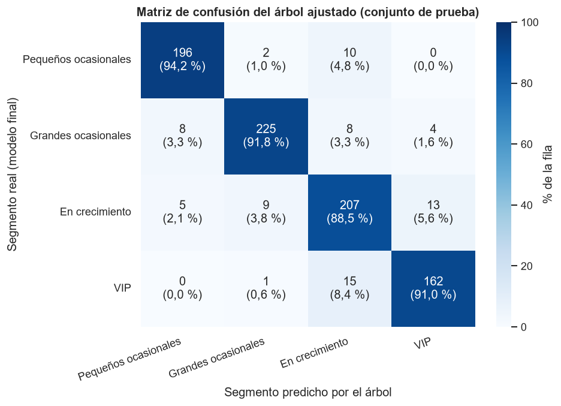

*Figura 18. Matriz de confusión del árbol ajustado en el conjunto de prueba*

Un árbol de solo profundidad 3 acierta el 82,0 % en prueba con reglas que se leen en unidades de negocio:

- Número de facturas ≤ 4,5 y Ticket promedio (£) ≤ 264,8 y Productos distintos ≤ 23,5 → **Pequeños ocasionales**
- Número de facturas ≤ 4,5 y Ticket promedio (£) ≤ 264,8 y Productos distintos > 23,5 → **En crecimiento**
- Número de facturas ≤ 4,5 y Ticket promedio (£) > 264,8 y Días desde la última compra ≤ 37,5 → **En crecimiento**
- Número de facturas ≤ 4,5 y Ticket promedio (£) > 264,8 y Días desde la última compra > 37,5 → **Grandes ocasionales**
- Número de facturas > 4,5 y Productos distintos ≤ 79,5 y Número de facturas ≤ 6,5 → **En crecimiento**
- Número de facturas > 4,5 y Productos distintos ≤ 79,5 y Número de facturas > 6,5 → **VIP**
- Número de facturas > 4,5 y Productos distintos > 79,5 y Días desde la última compra ≤ 73,5 → **VIP**
- Número de facturas > 4,5 y Productos distintos > 79,5 y Días desde la última compra > 73,5 → **VIP**

### 7.4 Ajustes de hiperparámetros

*Tabla 5. Hiperparámetros y decisiones de modelado probados, valor elegido y criterio.*

| Etapa | Parámetro | Valores probados | Elegido | Criterio |
|---|---|---|---|---|
| Preprocesado | Transformación | sin transformar / log1p | log1p | Las cuatro variables son muy asimétricas; con log1p quedan casi simétricas (comparación de asimetría, notebook 02) |
| Preprocesado | Escalado | StandardScaler / RobustScaler | StandardScaler | Todas las variables pesan igual en la distancia; RobustScaler daba más peso al ticket sin razón de negocio |
| Preprocesado | Valores extremos | mantener / winsorizar | winsorizar p1–p99 (en log1p) | Los extremos ya no arrastran los centroides de K-Means |
| Preprocesado | Variables del clustering | 4 variables + gasto total (VIF) + tasa de devoluciones | recency, frequency, ticket_promedio, productos_distintos | Gasto = facturas × ticket (redundante, VIF); la tasa de devoluciones creaba un cluster solo de devolvedores |
| K-Means | Número de clusters k | 2 a 10 | 4 | k = 2 gana en métricas pero no es accionable; k = 4 es estable y k = 5 es inestable |
| K-Means | Inicializaciones (n_init) | — | 10 (k-means++) | Se queda con la mejor de 10 inicializaciones |
| GMM | Tipo de covarianza × k | diag, full, spherical, tied × k 2 a 10 | full, k = 7 | Menor BIC |
| GMM | reg_covar | 1e-6 a 0,1 (10 valores) | 0,05 | Mínimo valor sin componentes degenerados por los empates de frecuencia = 1 |
| DBSCAN | eps | codo de las distancias al 8.º vecino | 0,717 | Punto de máxima curvatura del gráfico de k-distancias |
| DBSCAN | min_samples | regla 2 × nº de variables | 8 | Regla habitual de la literatura |
| HDBSCAN | min_cluster_size | 2 % de los clientes | 86 | Tamaño mínimo de un segmento útil |
| t-SNE | perplexity | 5, 30, 50, 100 | 30 | Equilibrio entre estructura local y global (solo para visualizar) |
| Árbol de decisión | max_depth × min_samples_leaf | 9 × 4 = 36 combinaciones | 10 y 1 | Mayor exactitud en validación cruzada de 5 pliegues |

### 7.5 Decisión

Se eligió **K-Means con k = 4**:

- **Métricas:** silhouette 0,240, Davies-Bouldin 1,282 y Calinski-Harabasz
  1.926.
- **Estabilidad:** mediana 0,958 y percentil 10 0,929.
- **Robustez a los empates:** ARI 0,941.
- **Exactitud con clientes no vistos:** 98,2 % de reasignación; un árbol de decisión reproduce los
  segmentos con un 91,3 % de exactitud en prueba.
- **Negocio:** segmentos accionables de tamaño útil.

Las métricas y el negocio no coinciden: las métricas premian k = 2. Es lo esperable en una nube continua, donde el
silhouette siempre favorece el k mínimo, y k = 2 solo separa a los clientes activos del resto (su segmento menor tiene
el 41,8 % de los clientes), sin permitir estrategias diferenciadas.

**¿Es aceptable un silhouette de 0,240?** Sí, en este contexto. El silhouette mide lo separados que están
los grupos. En la escala de Kaufman y Rousseeuw (1990), un valor por debajo de 0,25 indica que no hay una estructura de
grupos sustancial, y eso coincide con lo que muestran DBSCAN y HDBSCAN: los clientes forman un continuo. Aquí el objetivo no es
descubrir grupos naturales, sino **particionar ese continuo** en segmentos útiles. Para eso importa que la partición
sea estable, robusta e interpretable, y lo es.

## 8. Resultados: perfiles de los segmentos

*Tabla 6. Perfil de los segmentos (medianas).*

| Segmento | Clientes | % clientes | % ingresos | Recency (días) | Facturas | Ticket mediano | Productos | Gasto mediano |
|---|---|---|---|---|---|---|---|---|
| Pequeños ocasionales | 1.040 | 24,1 % | 2,7 % | 165 | 1 | 139,34 £ | 9 | 176,92 £ |
| Grandes ocasionales | 1.226 | 28,4 % | 15,8 % | 110 | 1 | 417,92 £ | 32 | 655,66 £ |
| En crecimiento | 1.170 | 27,1 % | 11,3 % | 23 | 3 | 228,74 £ | 44 | 700,22 £ |
| VIP | 888 | 20,5 % | 70,2 % | 11 | 8 | 381,85 £ | 123 | 3.098,15 £ |
| ↳ Cuentas clave (subgrupo de VIP) | 66 | 1,5 % | 32,3 % | 8 | 26 | 1.078,19 £ | 85 | 23.278,22 £ |

- **VIP:** compran a menudo (8 facturas de mediana), hace poco (11 días) y mucha
  variedad (123 productos). Generan el 70,2 % de los ingresos con el 20,5 % de los
  clientes. El 94,7 % son "Campeones" o "Leales" según RFM.
- **En crecimiento:** clientes recientes (95,6 % compró en los últimos 90 días) que ya repiten. Una parte entró
  en la campaña de Navidad.
- **Grandes ocasionales:** el ticket más alto (417,92 £), pero el 53,2 % compró una sola vez. El
  43,9 % de sus clientes de una compra lo hizo en septiembre–noviembre, un patrón de
  aprovisionamiento para Navidad.
- **Pequeños ocasionales:** pedidos pequeños (ticket de 139,34 £, 9 productos) y de vez en cuando. Aportan el
  2,7 % de los ingresos.

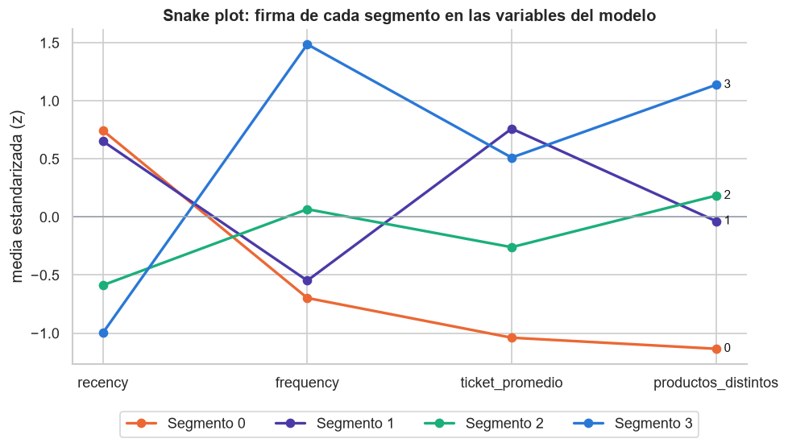

*Figura 19. Snake plot: media estandarizada de las variables por segmento*

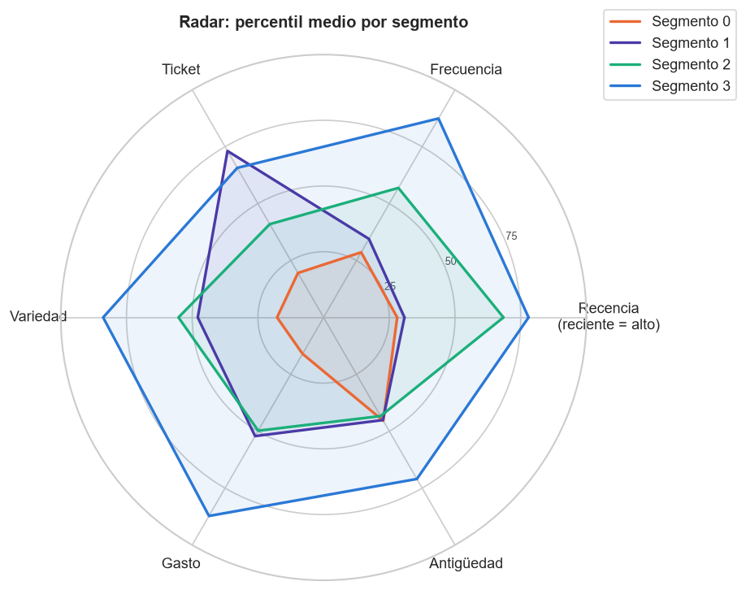

*Figura 20. Radar: percentil medio de cada segmento*

**Valor añadido frente al baseline RFM.** Para RFM, Pequeños ocasionales y Grandes ocasionales son casi lo mismo: el 88 % y el
90 % son clientes hibernando o en riesgo. K-Means los separa por el tamaño del pedido y su valor es muy
distinto: el 2,7 % frente al 15,8 % de los ingresos. Por eso merecen inversiones de reactivación
distintas.

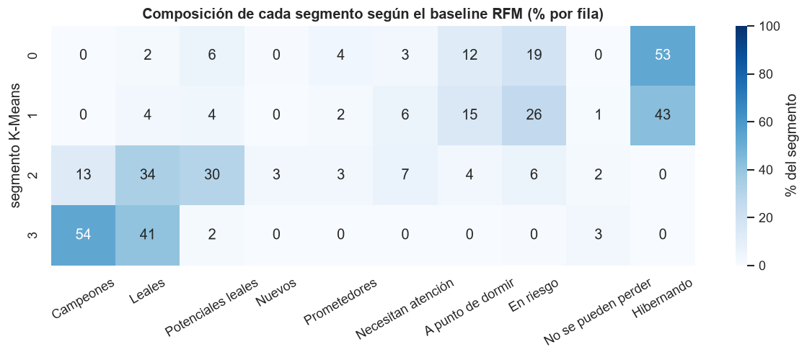

*Figura 21. Composición de cada segmento según el baseline RFM*

**Cuentas clave.** Los atípicos de DBSCAN se concentran en VIP. El subgrupo de cuentas clave reúne a los VIP atípicos
que gastan al menos la mediana del resto de VIP (2.936,20 £). Son 66 clientes (1,5 %) que
generan el 32,3 % de los ingresos: compran 26 veces de mediana, con un ticket de 1.078,19 £.

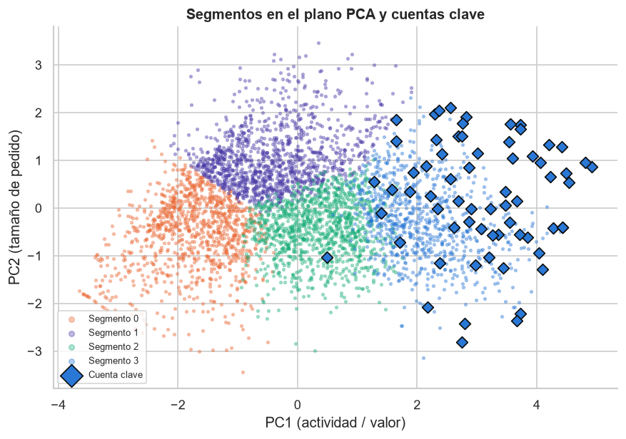

*Figura 22. Segmentos en el plano PCA y cuentas clave (rombos)*

**Estacionalidad.** El 45,9 % de las facturas de En crecimiento son de septiembre–noviembre (el más
estacional), y el 25,5 % del segmento hizo su primera compra desde octubre de 2011. El mes de compra no
es independiente de la recency, así que estas cifras se interpretan con cautela.

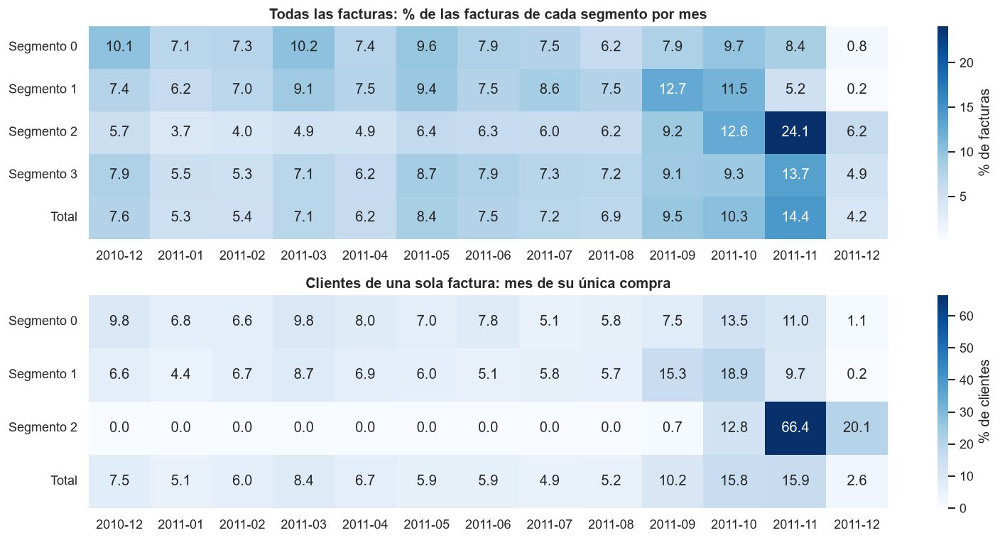

*Figura 23. Estacionalidad de cada segmento*

## 9. Estrategias de marketing

Cada estrategia tiene una acción concreta, el momento de aplicarla y un KPI. La línea base es el valor actual del
indicador, calculado con los datos; no se fijan metas inventadas.

**Pequeños ocasionales**

1. **Acción:** Reactivación de bajo coste para quienes llevan más de 90 días sin comprar: un único email automatizado con cupón de un solo uso y una selección de los productos más vendidos. **Momento:** Octubre, al empezar la demanda de regalos de Navidad. **KPI:** Tasa de reactivación (% que compra en los 60 días siguientes) y coste por cliente reactivado. **Línea base actual:** 66,3 %.
2. **Acción:** Segunda compra para los recientes: email automático con envío gratis a partir de un pedido mínimo algo superior a su primer pedido. **Momento:** 30 días después de su primera compra. **KPI:** % que hace una segunda compra en los 90 días siguientes y ticket de esa segunda compra. **Línea base actual:** 33,7 %.
3. **Acción:** Higiene de la base: tras dos campañas sin respuesta, pasar a comunicación trimestral y excluirlos de acciones con coste (descuentos, envíos de catálogo). **Momento:** Al cerrar la campaña de octubre–noviembre. **KPI:** Coste de marketing por libra de ingresos del segmento. **Línea base actual:** 2,7 %.

**Grandes ocasionales**

1. **Acción:** Campaña de pre-temporada para quienes compraron en septiembre–noviembre: catálogo de Navidad anticipado con condiciones de mayorista. **Momento:** Finales de agosto e inicio de septiembre, antes de su ventana habitual de compra. **KPI:** % de estos clientes que vuelve a comprar entre septiembre y noviembre. **Línea base actual:** 43,9 %.
2. **Acción:** Llamada comercial a los clientes de pedidos grandes puntuales (marcados como atípicos) para proponer un acuerdo de reposición. **Momento:** Primer trimestre, fuera de la temporada alta. **KPI:** % que hace una segunda compra en los 90 días siguientes al contacto. **Línea base actual:** 53,2 %.
3. **Acción:** Encuesta breve sobre por qué no repitieron, con un incentivo por responder. **Momento:** 60 días después de su compra si no han repetido. **KPI:** Tasa de respuesta y % de encuestados que hace una segunda compra. **Línea base actual:** 53,2 %.

**En crecimiento**

1. **Acción:** Secuencia de recompra: email con productos complementarios a lo que ya compraron. **Momento:** 21 días después de cada pedido (automático). **KPI:** Tasa de recompra a 60 días. **Línea base actual:** 42,3 %.
2. **Acción:** Retener a los captados en Navidad: oferta para la primera compra del año. **Momento:** Enero–febrero, los meses de menor actividad. **KPI:** % de los captados en octubre–diciembre que vuelve a comprar en enero–febrero. **Línea base actual:** 25,5 %.
3. **Acción:** Subir el ticket: envío gratis a partir de un pedido mínimo por encima de su ticket actual y packs de productos. **Momento:** Desde su siguiente pedido. **KPI:** Ticket promedio del segmento. **Línea base actual:** 228,74 £.

**VIP**

1. **Acción:** Programa VIP: acceso anticipado a la colección de Navidad y descuento escalonado por volumen anual. **Momento:** Agosto, antes del pico de pedidos de septiembre–noviembre. **KPI:** % de VIP que compra en septiembre–noviembre. **Línea base actual:** 96,8 %.
2. **Acción:** Alerta de abandono: si un VIP supera 1,5 veces su intervalo habitual entre compras sin pedir, contacto personal del equipo comercial. **Momento:** Revisión semanal automática durante todo el año. **KPI:** % de VIP sin compras en los últimos 90 días. **Línea base actual:** 1,7 %.
3. **Acción:** Revisión de las causas de devolución con los VIP que más devuelven (producto, embalaje, transporte) y gestión prioritaria de sus incidencias. **Momento:** Trimestral. **KPI:** % de VIP con devoluciones y tasa media de devolución. **Línea base actual:** 59,2 %.

**Cuentas clave (VIP)**

1. **Acción:** Gestor de cuenta dedicado con condiciones negociadas: precios por volumen, plazos de pago y reposición programada. **Momento:** Revisión trimestral; negociación anual en julio–agosto, antes de la temporada. **KPI:** % de cuentas clave con compra en los últimos 90 días y % de los ingresos totales que aportan. **Línea base actual:** 97,0 %.
2. **Acción:** Planificación conjunta del pedido de Navidad con previsión de stock por cliente. **Momento:** Julio–agosto. **KPI:** Ingresos del subgrupo en septiembre–noviembre frente al año anterior. **Línea base actual:** 973.121,81 £.

## 10. Aplicativo web

El aplicativo, desarrollado en Streamlit y Plotly, tiene seis páginas:

1. **Inicio:** objetivo, indicadores clave y hallazgos principales.
2. **Exploración:** limpieza y patrones de venta.
3. **Modelos y validación:** comparación de los algoritmos, justificación del modelo final, exactitud con datos de
   prueba, reglas del árbol de decisión y tabla de ajustes.
4. **Clusters:** PCA 2D y 3D y t-SNE, con selector de algoritmo y la advertencia sobre t-SNE.
5. **Perfiles y estrategias.**
6. **Explorador:** filtros, búsqueda por cliente, descarga en CSV y clasificación de un cliente nuevo.

Para clasificar un cliente nuevo se aplica exactamente el preprocesamiento del entrenamiento, incluido el recorte p1–p99,
y se reproduce la regla de cuenta clave. El atípico se decide por cercanía a los puntos núcleo de DBSCAN. Las pruebas
comprueban que el formulario reproduce el segmento de los 4.324 clientes. La aplicación se probó en un entorno con
solo las dependencias de despliegue y en un contenedor Docker.

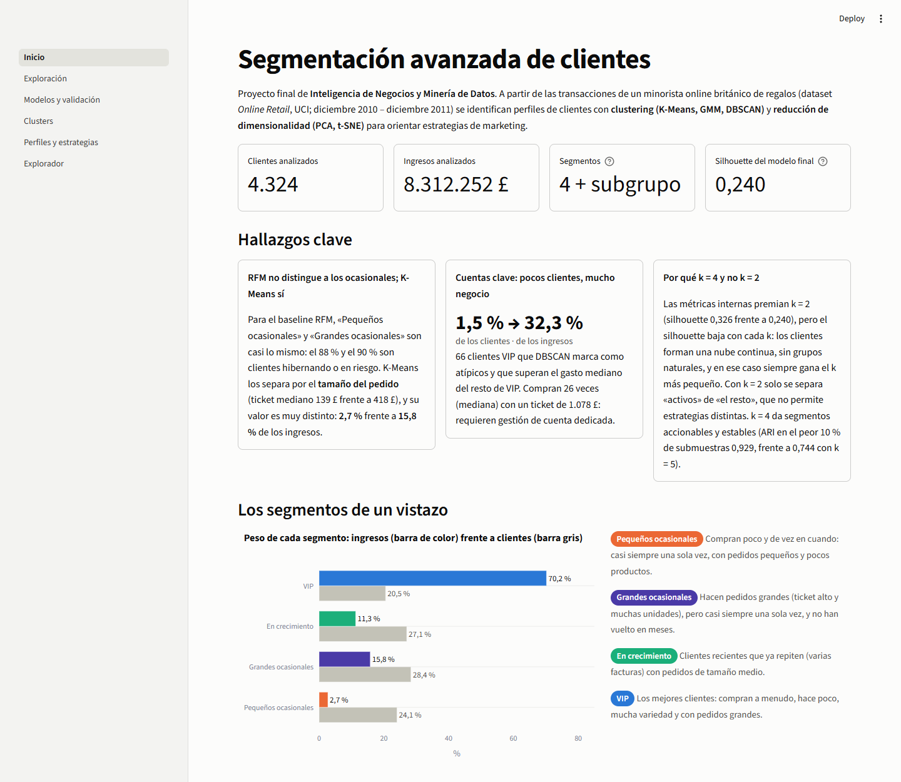

*Figura 24. Página de inicio del aplicativo*

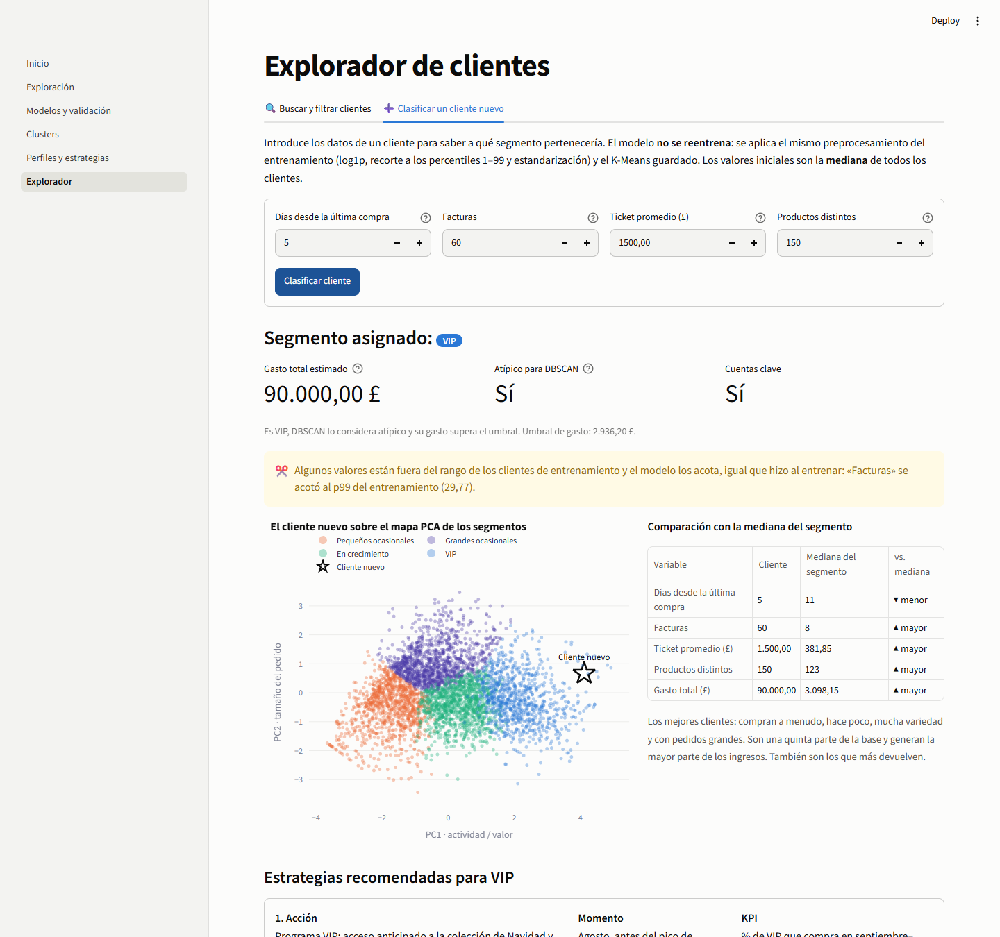

*Figura 25. Clasificación de un cliente nuevo sobre el mapa PCA*

## 11. Conclusiones

1. Una limpieza cuidadosa cambia el resultado. Sin el emparejamiento de compras anuladas aparecerían clientes con
   decenas de miles de libras de gasto que en realidad no compraron.
2. Las variables de clustering se eligieron por redundancia (VIF y correlación), por si estaban definidas para todos los
   clientes y por su efecto en el modelo. Así se descartaron el gasto total, la antigüedad, los días entre compras y la
   tasa de devoluciones, que se usan para perfilar.
3. K-Means con k = 4 es el mejor equilibrio entre métricas, estabilidad y utilidad. Las métricas internas solas
   habrían llevado a k = 2.
4. Los métodos de densidad confirmaron que los clientes forman un continuo. Su aporte fue detectar atípicos, de donde
   sale el subgrupo de cuentas clave (1,5 % de los clientes y 32,3 % de los ingresos).
5. Frente al baseline RFM, el clustering distingue a los ocasionales de pedido grande de los de pedido pequeño, una
   diferencia con impacto directo en cómo invertir en reactivación.
6. Aunque el silhouette es moderado, los segmentos son reproducibles: con clientes que el modelo no vio, la
   reasignación coincide en el 98,2 % de los casos y un árbol de decisión los reconoce con un
   91,3 % de exactitud, con reglas sencillas que se pueden explicar a negocio.

## 12. Limitaciones y trabajo futuro

- Se excluyó el 24,93 % de las líneas, sin cliente identificado; la segmentación no describe a esos
  compradores.
- Con un solo año de datos no se puede separar del todo la estacionalidad del crecimiento ni confirmar que los
  compradores de temporada repitan cada Navidad.
- La segmentación es una foto fija: con datos nuevos habría que recalcular las variables y vigilar la estabilidad.
- Las estrategias no se han probado. El siguiente paso es medirlas con grupos de control contra las líneas base
  indicadas.
- Como trabajo futuro: incorporar información de producto (categorías) y modelos de valor de vida del cliente (CLV).

## Referencias

- Arthur, D. y Vassilvitskii, S. (2007). k-means++: The advantages of careful seeding. *Proceedings of the 18th Annual
  ACM-SIAM Symposium on Discrete Algorithms*, 1027–1035.
- Breiman, L. (2001). Random forests. *Machine Learning*, 45(1), 5–32.
- Breiman, L., Friedman, J. H., Olshen, R. A. y Stone, C. J. (1984). *Classification and Regression Trees*. Wadsworth.
- Caliński, T. y Harabasz, J. (1974). A dendrite method for cluster analysis. *Communications in Statistics*, 3(1), 1–27.
- Campello, R. J. G. B., Moulavi, D. y Sander, J. (2013). Density-based clustering based on hierarchical density
  estimates. *Advances in Knowledge Discovery and Data Mining (PAKDD)*, 160–172.
- Chen, D., Sahinoglu, Z. y Guo, Y. (2012). Data mining for the online retail industry: A case study of RFM model-based
  customer segmentation using data mining. *Journal of Database Marketing & Customer Strategy Management*, 19(3),
  197–208.
- Davies, D. L. y Bouldin, D. W. (1979). A cluster separation measure. *IEEE Transactions on Pattern Analysis and
  Machine Intelligence*, 1(2), 224–227.
- Ester, M., Kriegel, H.-P., Sander, J. y Xu, X. (1996). A density-based algorithm for discovering clusters in large
  spatial databases with noise. *Proceedings of the 2nd International Conference on Knowledge Discovery and Data
  Mining (KDD)*, 226–231.
- Hennig, C. (2007). Cluster-wise assessment of cluster stability. *Computational Statistics & Data Analysis*, 52(1),
  258–271.
- Hubert, L. y Arabie, P. (1985). Comparing partitions. *Journal of Classification*, 2(1), 193–218.
- Hughes, A. M. (1994). *Strategic Database Marketing*. Probus Publishing.
- Kaufman, L. y Rousseeuw, P. J. (1990). *Finding Groups in Data: An Introduction to Cluster Analysis*. John Wiley &
  Sons.
- Kohavi, R. (1995). A study of cross-validation and bootstrap for accuracy estimation and model selection.
  *Proceedings of the 14th International Joint Conference on Artificial Intelligence (IJCAI)*, 2, 1137–1143.
- Kuhn, H. W. (1955). The Hungarian method for the assignment problem. *Naval Research Logistics Quarterly*, 2(1–2),
  83–97.
- Lange, T., Roth, V., Braun, M. L. y Buhmann, J. M. (2004). Stability-based validation of clustering solutions.
  *Neural Computation*, 16(6), 1299–1323.
- MacQueen, J. (1967). Some methods for classification and analysis of multivariate observations. *Proceedings of the
  Fifth Berkeley Symposium on Mathematical Statistics and Probability*, 1, 281–297.
- Pedregosa, F. et al. (2011). Scikit-learn: Machine learning in Python. *Journal of Machine Learning Research*, 12,
  2825–2830.
- Rousseeuw, P. J. (1987). Silhouettes: A graphical aid to the interpretation and validation of cluster analysis.
  *Journal of Computational and Applied Mathematics*, 20, 53–65.
- Schubert, E., Sander, J., Ester, M., Kriegel, H.-P. y Xu, X. (2017). DBSCAN revisited, revisited: Why and how you
  should (still) use DBSCAN. *ACM Transactions on Database Systems*, 42(3), 1–21.
- Schwarz, G. (1978). Estimating the dimension of a model. *The Annals of Statistics*, 6(2), 461–464.
- UCI Machine Learning Repository. Online Retail [Dataset]. https://archive.ics.uci.edu/dataset/352/online+retail
- van der Maaten, L. y Hinton, G. (2008). Visualizing data using t-SNE. *Journal of Machine Learning Research*, 9,
  2579–2605.
- Wattenberg, M., Viégas, F. y Johnson, I. (2016). How to use t-SNE effectively. *Distill*.
  https://doi.org/10.23915/distill.00002
