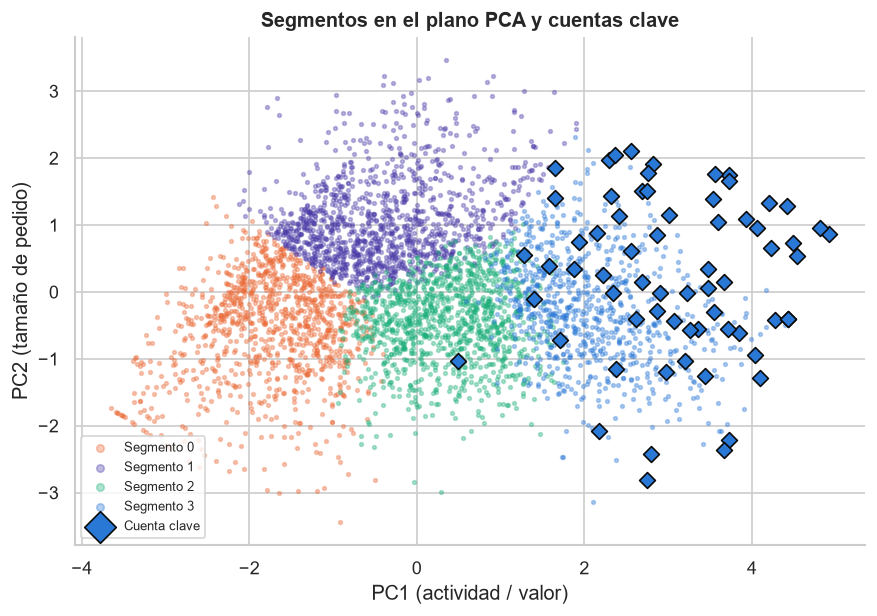
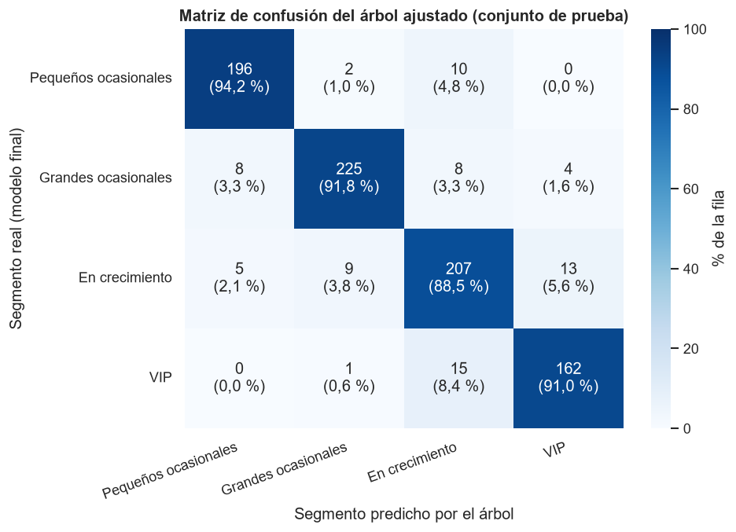

# Segmentación de clientes: resumen para la exposición

Proyecto final · Inteligencia de Negocios y Minería de Datos · Ingeniería de Software

## Cómo usar este resumen

Es la versión corta del informe, pensada para preparar la exposición. Cada apartado trae **lo que hay que decir** y las
cifras que lo respaldan; todas salen del código del proyecto (`python -m segmentacion.reportes`). Al final hay
preguntas probables con respuestas cortas. Para profundizar: informe completo y guía de sustentación
(31 preguntas).

**La idea en una frase:** agrupamos a los 4.324 clientes de una tienda online según cómo compran, comparamos tres
familias de algoritmos y elegimos **K-Means con 4 segmentos**, que son estables, se reproducen con clientes nuevos
(98,2 % de coincidencia) y permiten estrategias de marketing distintas para cada grupo.

**App publicada:** https://segmentacion-retail-ucc.streamlit.app

## 1. Orden sugerido de la exposición

1. **Problema y datos:** qué es el dataset y por qué segmentar.
2. **Limpieza:** el hallazgo de las compras anuladas.
3. **Variables:** las cuatro variables y su preparación.
4. **Modelos:** K-Means, GMM y DBSCAN; por qué k = 4.
5. **Validación:** pruebas, exactitud con datos de prueba y ajustes.
6. **Resultados:** los segmentos, las cuentas clave y las estrategias.
7. **Demostración de la app** y cierre.

## 2. Problema y datos

- **Dataset:** *Online Retail* (UCI), un minorista online británico de artículos de regalo. Transacciones del
  1 de diciembre de 2010 al 9 de diciembre de 2011: 541.909 líneas de factura, 37 países y 3.646 productos.
- **Problema:** tratar a todos los clientes por igual desperdicia recursos. El análisis RFM clásico (recencia,
  frecuencia, gasto) usa cortes arbitrarios por quintiles; el clustering busca los grupos a partir de los datos.
- **Objetivo:** segmentar con clustering y reducción de dimensionalidad, validar los segmentos, perfilarlos, proponer
  estrategias y publicar un dashboard.

## 3. Limpieza: lo importante

- Se quitaron duplicados, líneas sin cliente (24,93 % de las líneas), códigos que no son productos y
  cantidades o precios no positivos.
- **El hallazgo clave:** las cancelaciones anulan compras anteriores. Borrar solo las facturas «C» deja la compra
  original como si se hubiera hecho; el mayor pedido del dataset (80.995 unidades) se canceló minutos
  después. Se emparejó cada cancelación con su compra (1 a 1) y se quitaron ambas: **2.731 compras
  anuladas**.
- **Resultado:** 388.422 líneas de venta de **4.324 clientes**, con 8.312.251,80 £ de ingresos.

## 4. Variables y preparación

- **Variables del clustering** (una fila por cliente): días desde la última compra, número de facturas, ticket promedio
  y productos distintos.
- **Fuera del clustering, solo para perfilar:** el gasto total (es facturas × ticket, redundante), la tasa de
  devoluciones (creaba un grupo solo de devolvedores), los días entre compras (no existen para el 34,8 % de
  clientes con una sola compra) y el país.
- **Preparación:** log1p (las variables tienen colas muy largas), recorte a los percentiles 1–99 (los extremos no
  arrastran los centroides) y estandarización (todas pesan igual).

## 5. Modelos y elección

*Tabla 1. Modelos comparados (silhouette: separación de los grupos; estabilidad: ARI en el peor 10 % de 50 submuestras).*

| Modelo | Silhouette | Estabilidad (peor 10 %) | Veredicto |
|---|---|---|---|
| K-Means k = 2 | 0,326 | 0,955 | Mejor métrica, pero solo separa activos de inactivos |
| **K-Means k = 4** | **0,240** | **0,929** | **Elegido:** estable y accionable |
| K-Means k = 5 | 0,232 | 0,744 | Inestable: dos soluciones casi empatadas |
| GMM (full, k = 7) | 0,145 | 0,378 | Peor en todo; necesitó `reg_covar` = 0,05 |
| DBSCAN | — | — | Un solo grupo y 163 atípicos: no hay grupos por densidad |

- **Por qué k = 4 y no k = 2:** el silhouette baja con cada k porque los clientes forman una nube continua; en
  ese caso siempre gana el k más pequeño. Con k = 2 no hay estrategias distintas que proponer.
- **PCA** resume los datos en dos ejes que explican el 80,2 %: PC1 = actividad / valor y PC2 = tamaño del pedido. Se
  usa para interpretar y dibujar. **t-SNE** solo sirve para visualizar: no conserva distancias ni tamaños.

*Figura 1. Segmentos sobre el mapa PCA, con las cuentas clave marcadas (0 = Pequeños ocasionales, 1 = Grandes ocasionales, 2 = En crecimiento, 3 = VIP)*

## 6. Validación: pruebas, exactitud y ajustes

**Pruebas de validación del clustering** (no hay etiqueta real, así que se valida su calidad y su consistencia):

- **Métricas internas:** silhouette 0,240, Davies-Bouldin 1,282, Calinski-Harabasz
  1.926.
- **Estabilidad:** el modelo se repitió con 50 submuestras del 80 %. ARI mediano 0,958 (1 =
  mismos grupos) y 0,929 en el peor 10 %.
- **Robustez:** ARI 0,941 al repartir al azar los empates de la frecuencia.

**Exactitud con datos de entrenamiento y de prueba.** La exactitud clásica necesita una respuesta correcta, y en
clustering no hay «segmento verdadero». Por eso se mide con clientes que el modelo **no vio al entrenar**:

- **Reasignación (5 pliegues):** se reentrena todo sin un 20 % de los clientes y se les asigna segmento.
  Coincide con el modelo final en el **98,2 %** de los casos (entre 96,8 % y
  99,3 %).
- **Clasificadores** con partición 80 % entrenamiento / 20 % prueba (865
  clientes de prueba):

*Tabla 2. Exactitud de los clasificadores que aprenden los segmentos.*

| Clasificador | Exactitud en validación cruzada | Exactitud en prueba |
|---|---|---|
| Árbol de decisión (profundidad 3) | 79,4 % ± 1,8 % | 82,0 % |
| Árbol de decisión ajustado | 91,6 % ± 1,5 % | 91,3 % |
| Bosque aleatorio (300 árboles) | 95,3 % ± 0,5 % | 94,7 % |

- **Lectura:** la exactitud en prueba es casi igual a la de validación cruzada, así que el modelo no está
  sobreajustado. Los errores se concentran en En crecimiento, el segmento intermedio, y son siempre entre segmentos
  vecinos.

*Figura 2. Matriz de confusión del árbol ajustado en el conjunto de prueba*

**Ajustes de hiperparámetros.** Todo lo que se probó y el criterio de elección:

*Tabla 3. Ajustes del proyecto.*

| Etapa | Parámetro | Valores probados | Elegido | Criterio |
|---|---|---|---|---|
| Preprocesado | Transformación | sin transformar / log1p | log1p | Las cuatro variables son muy asimétricas; con log1p quedan casi simétricas (comparación de asimetría, notebook 02) |
| Preprocesado | Escalado | StandardScaler / RobustScaler | StandardScaler | Todas las variables pesan igual en la distancia; RobustScaler daba más peso al ticket sin razón de negocio |
| Preprocesado | Valores extremos | mantener / winsorizar | winsorizar p1–p99 (en log1p) | Los extremos ya no arrastran los centroides de K-Means |
| Preprocesado | Variables del clustering | 4 variables + gasto total (VIF) + tasa de devoluciones | recency, frequency, ticket_promedio, productos_distintos | Gasto = facturas × ticket (redundante, VIF); la tasa de devoluciones creaba un cluster solo de devolvedores |
| K-Means | Número de clusters k | 2 a 10 | 4 | k = 2 gana en métricas pero no es accionable; k = 4 es estable y k = 5 es inestable |
| K-Means | Inicializaciones (n_init) | — | 10 (k-means++) | Se queda con la mejor de 10 inicializaciones |
| GMM | Tipo de covarianza × k | diag, full, spherical, tied × k 2 a 10 | full, k = 7 | Menor BIC |
| GMM | reg_covar | 1e-6 a 0,1 (10 valores) | 0,05 | Mínimo valor sin componentes degenerados por los empates de frecuencia = 1 |
| DBSCAN | eps | codo de las distancias al 8.º vecino | 0,717 | Punto de máxima curvatura del gráfico de k-distancias |
| DBSCAN | min_samples | regla 2 × nº de variables | 8 | Regla habitual de la literatura |
| HDBSCAN | min_cluster_size | 2 % de los clientes | 86 | Tamaño mínimo de un segmento útil |
| t-SNE | perplexity | 5, 30, 50, 100 | 30 | Equilibrio entre estructura local y global (solo para visualizar) |
| Árbol de decisión | max_depth × min_samples_leaf | 9 × 4 = 36 combinaciones | 10 y 1 | Mayor exactitud en validación cruzada de 5 pliegues |

## 7. Resultados: los segmentos

*Tabla 4. Los cuatro segmentos (medianas por cliente).*

| Segmento | % clientes | % ingresos | Facturas | Ticket | Días sin comprar |
|---|---|---|---|---|---|
| VIP | 20,5 % | 70,2 % | 8 | 381,85 £ | 11 |
| En crecimiento | 27,1 % | 11,3 % | 3 | 228,74 £ | 23 |
| Grandes ocasionales | 28,4 % | 15,8 % | 1 | 417,92 £ | 110 |
| Pequeños ocasionales | 24,1 % | 2,7 % | 1 | 139,34 £ | 165 |

- **Cuentas clave:** dentro de VIP, 66 clientes que DBSCAN marca como atípicos y que gastan al menos la
  mediana del resto de VIP. Son el 1,5 % de los clientes y generan el **32,3 %** de los ingresos.
- **Frente al RFM:** RFM ve casi iguales a los dos grupos de ocasionales (88 % y 90 % hibernando
  o en riesgo); K-Means los separa por el tamaño del pedido, y su valor es muy distinto (2,7 % frente a
  15,8 % de los ingresos).

**Estrategia principal de cada segmento** (cada una tiene momento y KPI; el resto está en el informe):

- **VIP:** Programa VIP: acceso anticipado a la colección de Navidad y descuento escalonado por volumen anual. *KPI:* % de VIP que compra en septiembre–noviembre.
- **Cuentas clave:** Gestor de cuenta dedicado con condiciones negociadas: precios por volumen, plazos de pago y reposición programada. *KPI:* % de cuentas clave con compra en los últimos 90 días y % de los ingresos totales que aportan.
- **En crecimiento:** Secuencia de recompra: email con productos complementarios a lo que ya compraron. *KPI:* Tasa de recompra a 60 días.
- **Grandes ocasionales:** Campaña de pre-temporada para quienes compraron en septiembre–noviembre: catálogo de Navidad anticipado con condiciones de mayorista. *KPI:* % de estos clientes que vuelve a comprar entre septiembre y noviembre.
- **Pequeños ocasionales:** Reactivación de bajo coste para quienes llevan más de 90 días sin comprar: un único email automatizado con cupón de un solo uso y una selección de los productos más vendidos. *KPI:* Tasa de reactivación (% que compra en los 60 días siguientes) y coste por cliente reactivado.

## 8. La aplicación

Streamlit + Plotly, seis páginas: Inicio (indicadores y hallazgos), Exploración, Modelos y validación (incluye la
exactitud y los ajustes), Clusters (PCA 2D/3D y t-SNE), Perfiles y estrategias, y Explorador (filtros, búsqueda,
descarga en CSV y **clasificación de un cliente nuevo**). Para clasificar se usa exactamente el mismo preprocesamiento
del entrenamiento.

**Para la demo:** abrir la app unos minutos antes (Streamlit «duerme» las apps sin uso) y tener a mano un cliente de
ejemplo, como el 14646 (VIP · cuenta clave).

## 9. Preguntas probables y respuestas cortas

**1. ¿Cuál es la exactitud del modelo?**
En clustering no hay una respuesta correcta con la que comparar, así que se mide con clientes no vistos: el modelo les
asigna el mismo segmento en el **98,2 %** de los casos. Un árbol de decisión reconoce los segmentos con un
**91,3 %** en prueba y un bosque aleatorio con un **94,7 %**.

**2. ¿Por qué no se puede comparar con la exactitud de un modelo supervisado, como un 79 %?**
Porque miden cosas distintas. En un problema supervisado la exactitud depende de lo predecible que sea una etiqueta
real. Aquí mide que los segmentos son reproducibles con datos nuevos y explicables con reglas.

**3. ¿Qué pruebas hicieron para validar?**
Métricas internas, estabilidad en 50 submuestras (ARI 0,958), robustez a los empates
(0,941), concordancia con RFM, exactitud con entrenamiento y prueba, y 107 pruebas
automáticas del código con `pytest`.

**4. ¿Qué ajustes hicieron?**
13 en total: k de 2 a 10 en K-Means; tipo de covarianza, número de componentes y `reg_covar` en GMM; `eps` y
`min_samples` en DBSCAN; perplexity en t-SNE; escalado y recorte de extremos en el preprocesado; y una búsqueda en
rejilla de 36 combinaciones para el árbol de decisión.

**5. ¿Cómo evitaron el sobreajuste?**
Los hiperparámetros se eligieron con validación cruzada dentro del entrenamiento y el conjunto de prueba se usó una sola
vez. El árbol llega al 100,0 % en entrenamiento pero se estanca en 91,6 % en validación:
más profundidad solo memoriza.

**6. ¿No es circular entrenar un árbol con etiquetas de K-Means?**
El árbol no prueba que los segmentos sean «verdaderos», sino que son reproducibles con reglas sencillas en clientes no
vistos. Si fueran ruido, fallaría en prueba. La prueba más directa es la reasignación, que no usa otro modelo.

**7. ¿Están balanceadas las clases? ¿No infla eso la exactitud?**
Están balanceadas en número de clientes: el segmento mayor (Grandes ocasionales, 28,4 %) tiene solo
1,38 veces más clientes que el menor (VIP, 20,5 %), y la partición es
estratificada. La exactitud balanceada del árbol es 91,4 % y el F1 macro 91,4 %, casi igual a su
exactitud (91,3 %). El desbalance está en los ingresos (VIP aporta el 70,2 %): es un
hallazgo de negocio, no un problema del modelo.

**8. Las métricas dicen k = 2. ¿Por qué k = 4?**
El silhouette baja con cada k porque los datos son una nube continua, y ahí siempre gana el k mínimo. k = 2 solo separa
activos de inactivos; k = 4 es muy estable (peor caso 0,929) y da segmentos accionables.

**9. ¿Por qué no k = 5?**
En el peor 10 % de submuestras su estabilidad cae a 0,744: tiene dos soluciones casi empatadas y salta
de una a otra.

**10. Un silhouette de 0,240 es bajo. ¿Es aceptable?**
Sí. Mide la separación entre grupos, y los clientes forman un continuo (lo confirmaron DBSCAN y HDBSCAN). El objetivo es
dividir ese continuo en segmentos útiles, y para eso importan la estabilidad, la robustez y la interpretabilidad, que
son altas.

**11. ¿Por qué esas cuatro variables y no el gasto total?**
El gasto es facturas × ticket: incluirlo contaría la misma información dos veces. Frecuencia y ticket juntos ya lo
contienen y además separan dos comportamientos distintos.

**12. ¿Por qué log1p, recorte p1–p99 y estandarización?**
Las variables tienen colas muy largas: sin log1p unos pocos mayoristas definirían toda la geometría. El recorte evita que
los extremos arrastren los centroides sin sacar a nadie, y la estandarización hace que todas pesen igual.

**13. ¿Qué pasó con GMM?**
Un tercio de los clientes tiene una sola factura, y GMM ponía una campana de varianza casi cero sobre ese empate. Se
corrigió con `reg_covar` = 0,05, pero quedó peor que K-Means (silhouette 0,145).

**14. ¿Y DBSCAN?**
Con `eps` = 0,717 y `min_samples` = 8 encuentra un solo grupo y 163 atípicos: no hay grupos separados
por densidad. Se usa para detectar atípicos, de donde salen las cuentas clave.

**15. ¿Para qué PCA y t-SNE?**
PCA para interpretar y dibujar (dos ejes explican el 80,2 %). t-SNE solo para visualizar: no conserva distancias ni
tamaños, así que no sirve para validar.

**16. ¿Qué son las cuentas clave?**
66 clientes VIP atípicos para DBSCAN y con gasto alto: el 1,5 % de los clientes y el
32,3 % de los ingresos. Merecen un gestor de cuenta dedicado.

**17. ¿Qué aporta frente al RFM?**
RFM no distingue a los dos grupos de ocasionales; K-Means los separa por el tamaño del pedido (2,7 % frente
a 15,8 % de los ingresos), lo que cambia cuánto invertir en reactivar a cada uno.

**18. ¿Cómo clasifica la app a un cliente nuevo?**
No reentrena: carga el mismo preprocesador (con los límites del entrenamiento) y el mismo K-Means. Las pruebas
comprueban que reproduce el segmento de los 4.324 clientes y las 66 cuentas clave.

**19. ¿Por qué quitaron las líneas sin cliente?**
Porque se segmentan clientes y esas líneas (24,93 %) no se pueden asignar a nadie. Está declarado como
limitación.

**20. ¿Cómo sabrían si las estrategias funcionan?**
Cada estrategia tiene un KPI con su línea base actual. Se aplicaría a una parte del segmento, con otra como grupo de
control, y se compararía el KPI.

**21. ¿Cuáles son las limitaciones?**
Un solo año de datos (no separa estacionalidad de crecimiento), clientes sin identificar excluidos, segmentación como
foto fija que hay que recalcular, y estrategias aún sin probar.

## 10. Para cerrar

- Una buena limpieza cambia el resultado: sin emparejar las compras anuladas habría clientes con gastos que nunca
  existieron.
- Las métricas internas solas habrían elegido k = 2; la estabilidad y el negocio llevaron a k = 4.
- Los segmentos son consistentes y reproducibles (98,2 % con clientes nuevos) y cada uno tiene una
  estrategia medible.
